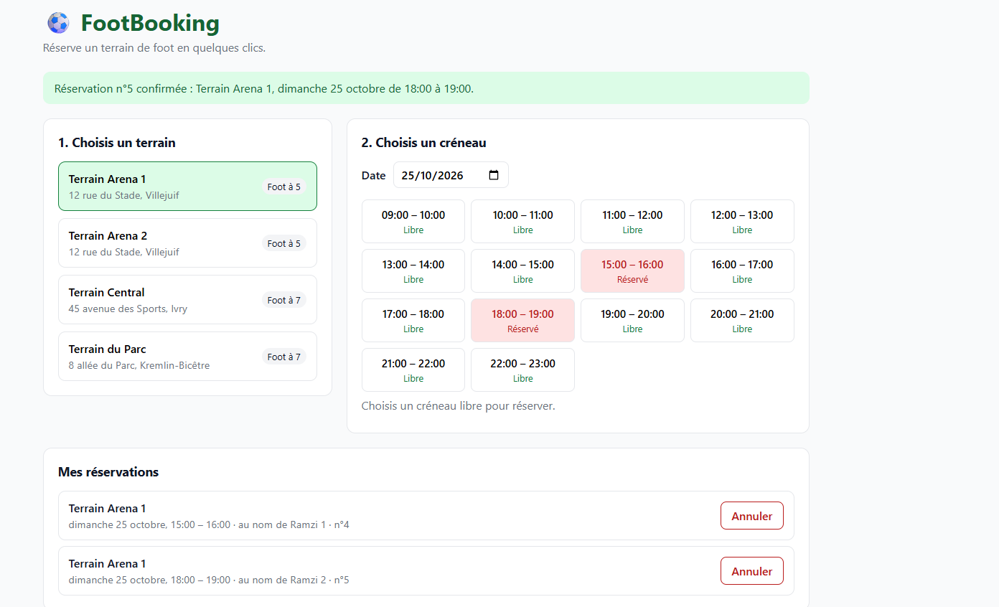
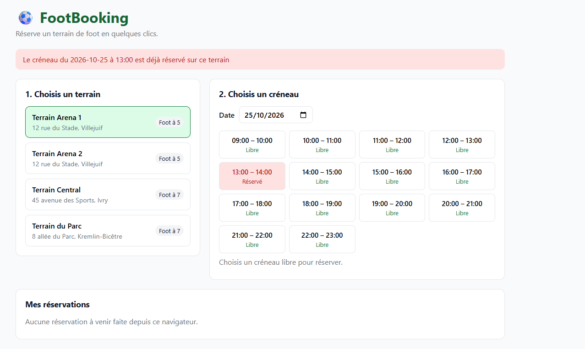
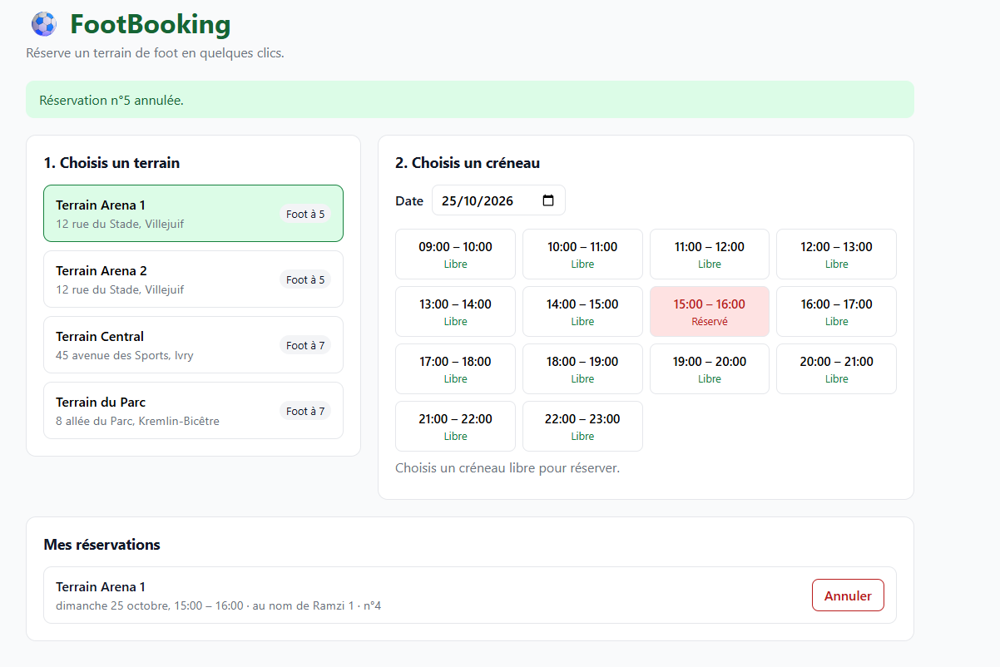
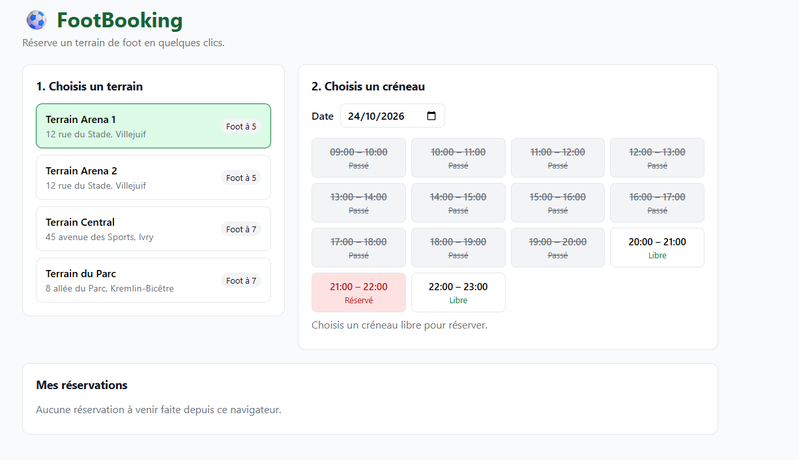
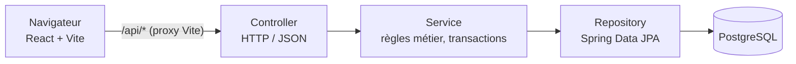

# ⚽ FootBooking


Application web de **réservation de terrains de foot** : on choisit un terrain et une date, on voit en temps réel les créneaux libres, réservés ou passés, et on réserve en saisissant son nom. Une réservation peut ensuite être annulée.

Projet personnel réalisé pour mettre en pratique une architecture back-end propre (API REST en couches avec Spring Boot), la gestion des règles métier et de la concurrence en base de données, et un front React qui consomme l'API.



## Fonctionnalités

- Lister les terrains (foot à 5, foot à 7)
- Afficher les créneaux d'1 h d'un terrain pour une date (9 h – 23 h), avec leur statut : **libre**, **réservé** ou **passé**
- Réserver un créneau libre en saisissant son nom
- **Impossible de réserver un créneau déjà pris**, même si deux personnes valident au même instant
- Annuler une réservation depuis la section « Mes réservations »
- Messages d'erreur clairs (créneau déjà pris, créneau passé, hors horaires, champs manquants…)

**Deux utilisateurs tentent de réserver le même créneau :** le second reçoit une erreur 409 et la page se met à jour.



| Annulation d'une réservation | Créneaux déjà passés |
|---|---|
|  |  |

## Stack technique

| Couche | Technologies |
|---|---|
| Back-end | Java 21, Spring Boot 4.1 (Web MVC, Data JPA, Validation), Maven |
| Base de données | PostgreSQL 17 (Docker), migrations **Flyway** |
| Front-end | React 19, Vite 8, `fetch` |
| Outils | Docker Compose, Git, VS Code, REST Client |

## Architecture



Le back-end suit une architecture en couches **controller → service → repository** :

- **Controller** : reçoit les requêtes HTTP, valide le format des données (`@Valid`) et renvoie les bons codes HTTP. Aucune logique métier.
- **Service** : porte les règles métier (créneau existant, pas dans le passé, pas déjà réservé) et délimite les transactions.
- **Repository** : accès à la base via Spring Data JPA.
- **DTO** séparés des entités JPA : l'API n'expose jamais directement le modèle de la base.
- **Gestion centralisée des erreurs** (`@RestControllerAdvice`) au format standard `ProblemDetail` (RFC 9457).

### Points techniques notables

- **Double protection contre la double réservation.** Le service vérifie d'abord si le créneau est libre (message d'erreur clair), et une **contrainte `UNIQUE (terrain_id, date_reservation, heure_debut)`** en base garantit la règle même si deux requêtes arrivent simultanément (*race condition*). L'erreur de contrainte est traduite en **409 Conflict**.
- **Créneaux calculés, pas stockés.** Les créneaux sont générés à la volée à partir des horaires d'ouverture ; une seule requête SQL récupère les heures déjà réservées (pas de problème N+1).
- **Horloge injectée (`java.time.Clock`)** au lieu de `LocalDateTime.now()`, avec le fuseau `Europe/Paris` : le statut « passé » est testable et ne dépend pas du fuseau du serveur.
- **Schéma versionné avec Flyway** (`ddl-auto: validate`) : la base est créée par des scripts SQL relus et versionnés, Hibernate se contente de vérifier la correspondance avec les entités.
- **Front :** appels réseau isolés dans `src/api/api.js`, réponses obsolètes ignorées quand l'utilisateur change vite de terrain, rechargement des créneaux après chaque réservation (y compris en cas de conflit).

## API REST

| Méthode | URL | Description | Réponses |
|---|---|---|---|
| `GET` | `/api/terrains` | Liste des terrains | 200 |
| `GET` | `/api/terrains/{id}/creneaux?date=AAAA-MM-JJ` | Créneaux d'un terrain avec leur statut | 200, 400, 404 |
| `POST` | `/api/reservations` | Réserver un créneau | **201**, 400, 404, **409** |
| `GET` | `/api/reservations/{id}` | Consulter une réservation | 200, 404 |
| `DELETE` | `/api/reservations/{id}` | Annuler une réservation | **204**, 404 |

Exemple de réservation :

```http
POST /api/reservations
Content-Type: application/json

{
  "terrainId": 1,
  "date": "2026-10-30",
  "heureDebut": "18:00",
  "nomClient": "Ramzy"
}
```

Le fichier [`api.http`](api.http) contient toutes les requêtes, y compris les cas d'erreur, exécutables directement avec l'extension VS Code **REST Client**.

## Lancer le projet

### Prérequis

- [Docker Desktop](https://www.docker.com/products/docker-desktop/)
- JDK 21 ou plus
- Node.js 20.19+ ou 22.12+

### 1. Démarrer la base de données

À la racine du projet :

```bash
docker compose up -d
```

PostgreSQL est exposé sur le port **55432** (pour ne pas entrer en conflit avec une installation locale de PostgreSQL).

### 2. Démarrer le back-end

```bash
cd backend
./mvnw spring-boot:run        # Windows : .\mvnw spring-boot:run
```

Au premier démarrage, Flyway crée les tables et insère 4 terrains de démonstration. L'API est disponible sur http://localhost:8080/api/terrains.

### 3. Démarrer le front-end

Dans un autre terminal :

```bash
cd frontend
npm install
npm run dev
```

L'application est disponible sur **http://localhost:5173**. Le serveur Vite redirige les appels `/api` vers le back-end.

## Structure du projet

```
foot-booking/
├── backend/
│   └── src/main/
│       ├── java/com/efrei/footbooking/
│       │   ├── config/         # Clock (fuseau Europe/Paris)
│       │   ├── controller/     # TerrainController, ReservationController
│       │   ├── dto/            # objets d'entrée / sortie de l'API
│       │   ├── exception/      # exceptions métier + GlobalExceptionHandler
│       │   ├── model/          # entités JPA Terrain, Reservation
│       │   ├── repository/     # Spring Data JPA
│       │   └── service/        # TerrainService, CreneauService, ReservationService
│       └── resources/
│           ├── application.yml
│           └── db/migration/   # scripts Flyway V1, V2
├── frontend/
│   └── src/
│       ├── api/                # appels à l'API
│       ├── components/         # TerrainList, CreneauList, ReservationForm, MesReservations
│       └── utils/
├── docs/screenshots/
├── api.http
└── docker-compose.yml
```

## Limites connues et évolutions prévues

La version 1 ne gère pas de comptes utilisateurs : « Mes réservations » est mémorisé dans le navigateur (localStorage), et une réservation peut être annulée par toute personne qui connaît son identifiant.

- [ ] Tests unitaires et d'intégration (JUnit 5, Mockito), dont un test de réservations simultanées
- [ ] Inscription / connexion avec Spring Security, rôle administrateur pour gérer les terrains
- [ ] Dockerfiles et `docker-compose` complet pour tout lancer en une commande
- [ ] Intégration continue avec GitHub Actions (tests à chaque push)

## Auteur

**Ramzy** – étudiant ingénieur à l'EFREI Paris, à la recherche d'une alternance en développement.
